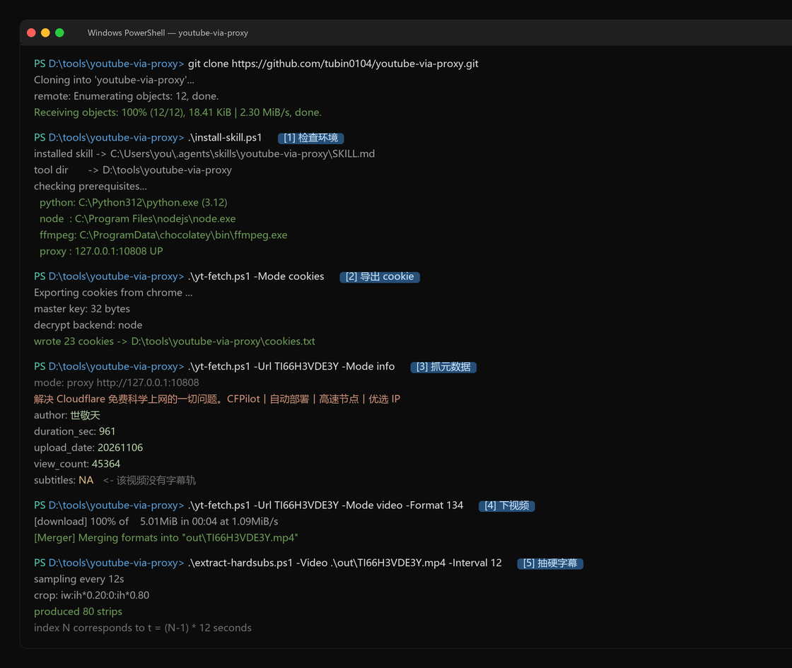

# youtube-via-proxy

> 在 Windows 上可靠地读取 YouTube 视频内容 —— 元数据、字幕、音频、视频，以及**从画面里抽取没有独立字幕轨的硬字幕**。

[](https://learn.microsoft.com/powershell/)
[](https://python.org)
[](LICENSE)

---

## 它解决什么问题

想用脚本或 AI 助手“看”一个 YouTube 视频，通常会撞上三道墙：

1. **直连不通** —— 需要走本地代理；
2. **`Sign in to confirm you're not a bot`** —— 匿名请求被判定为爬虫，所有播放器客户端一律拦截；
3. **`Requested format is not available`** —— 没解 YouTube 的 n-challenge，只能拿到图片格式。

这个项目把三件事一次做完，并且额外解决了一个很少被提及的坑：

4. **视频根本没有字幕轨** —— 中文技术频道常用“烧进画面”的硬字幕，`--list-subs` 返回空。
   本工具能把字幕条逐条切出来，交给视觉模型读。

## 使用演示



完整流程只需五步：克隆仓库 → 检查环境 → 导出 cookie → 抓元数据 → 下载视频 → 抽取硬字幕。

## 特性

- **自动探测环境**：代理端口、Python、Node、ffmpeg 全部自动找，不写死路径
- **无代理也能用**：探测不到本地代理就自动直连（境外网络场景）
- **cookie 自解密**：直接从 Chrome / Edge / Firefox 读取登录态，无需手动导出
- **纯标准库**：DPAPI 走 ctypes，AES-GCM 走 Node 内置 crypto，不依赖任何第三方 Python 包
- **可离线部署**：内置 yt-dlp 源码，目标机器无网络也能跑
- **硬字幕抽帧**：`extract-hardsubs.ps1` 一条命令产出全部字幕条

## 环境要求

| 组件 | 必需 | 说明 |
|---|---|---|
| Windows + PowerShell 5.1+ | ✅ | 已在 Windows 11 验证 |
| Python 3.8+ | ✅ | [python.org](https://python.org) 安装时勾选 *Add to PATH* |
| Node.js | 强烈建议 | cookie 解密优先用它；yt-dlp 解 n-challenge 也需要 |
| 本地 HTTP 代理 | 视网络 | 自动探测 `127.0.0.1:10808`，没有则直连 |
| ffmpeg | 可选 | 仅 `-Mode video` 与硬字幕抽帧需要 |

## 安装

```powershell
git clone https://github.com/<你的用户名>/youtube-via-proxy.git
cd youtube-via-proxy

# 校验环境（可选）
powershell -NoProfile -ExecutionPolicy Bypass -File .\install-skill.ps1
```

`install-skill.ps1` 会顺带检查 Python / Node / ffmpeg / 代理状态，并输出下一步提示。

### 作为 AI 助手技能安装（可选）

如果你用支持 skill 的助手（如 DeepSeek Harness）：

```powershell
powershell -NoProfile -ExecutionPolicy Bypass -File .\install-skill.ps1
```

这会把 `SKILL.md` 装进 `~/.agents/skills/youtube-via-proxy/`，并把里面的
`{{TOOL_DIR}}` 替换成当前实际路径。

## 使用

```powershell
# 首次：导出浏览器 cookie
.\yt-fetch.ps1 -Mode cookies

# 元数据
.\yt-fetch.ps1 -Url dQw4w9WgXcQ -Mode info

# 字幕轨（有的话）
.\yt-fetch.ps1 -Url <URL> -Mode subs

# 音频（m4a）
.\yt-fetch.ps1 -Url <URL> -Mode audio

# 视频（360p，适合抽帧）
.\yt-fetch.ps1 -Url <URL> -Mode video -Format 134

# 硬字幕抽帧
.\extract-hardsubs.ps1 -Video .\out\<ID>.mp4 -Interval 12
```

### 常用参数

| 参数 | 作用 |
|---|---|
| `-ProxyPort 7890` | 换代理端口 |
| `-ProxyPort 0` | 强制直连 |
| `-Browser edge\|firefox` | 换 cookie 来源（Chrome 读不出时） |
| `-Out <目录>` | 输出目录（默认 `.\out`） |
| `-Format <id>` | yt-dlp 格式选择器 |
| `-Crop "iw:ih*0.20:0:ih*0.80"` | 硬字幕裁剪区域 |

## 工作原理

### 代理与 TLS

脚本先探测本地代理端口。走代理时，某些代理对 YouTube 的 TLS 1.3 握手存在兼容问题
（表现为 `ERR_SSL_DECRYPTION_FAILED_OR_BAD_RECORD_MAC`）；yt-dlp 会自动降级重试。
若持续失败，换节点或用 `-ProxyPort 0` 直连。

### Cookie 解密

浏览器把 cookie 值用 AES-256-GCM 加密，密钥存在 `Local State` 里、由 Windows DPAPI
按用户保护。`scripts/export-cookies.py` 的流程：

```
Local State → DPAPI 解出 master key → 逐条 AES-GCM 解密 → Netscape cookie jar
```

细节：
- **Python 做 DPAPI**（ctypes 调 `CryptUnprotectData`），无需 pywin32
- **Node 做 AES-GCM**（内置 `crypto`），无需 `cryptography` 包
- Chrome 127+ 的明文前有 **32 字节二进制头**，自动剥离
- 兼容 v10 / v11 / v20 三种前缀
- 遇到 Chrome 的 app-bound 加密（解不开）时，改用 Edge / Firefox

### 无字幕轨时

```
video → ffmpeg 每 N 秒取一帧 → 裁底部条 → 放大到 1280 宽 → 逐张读
```

第 N 张对应 `t=(N-1)×Interval` 秒。相邻两张常重复，按语义合并即可。

## 故障排查

| 症状 | 处理 |
|---|---|
| `Sign in to confirm you're not a bot` | cookie 过期（约 40 天）→ `-Mode cookies` |
| `Requested format is not available` | 装 Node.js，或确认 EJS 组件已启用 |
| `database is locked` | 完全退出浏览器（含后台进程）再导出 |
| Chrome 导出 0 条 | 用 `-Browser edge` 或 `-Browser firefox` |
| `Python 3.8+ not found` | 安装 Python 并勾选 Add to PATH，或设 `$env:YTDLP_PYTHON` |
| `ffmpeg not found` | `winget install Gyan.FFmpeg` |

## 安全提醒

⚠️ **`cookies.txt` 等同一个账号的登录凭据**（含 `SID` / `HSAPISID` / `LOGIN_INFO`）。

- 已由 `.gitignore` 排除，不会被误提交
- 不要上传云盘、不要贴进聊天
- 不用了直接删，下次运行 `-Mode cookies` 重新生成

## 贡献

欢迎 issue 与 PR。提交前请确认：

- 不含任何个人路径或凭据
- 新增浏览器支持时同步更新 README 的表格

## 许可证

[MIT](LICENSE)

## 免责声明

本项目仅用于个人学习、研究与无障碍访问等合法用途。使用者需自行遵守
YouTube 服务条款及所在地法律法规。请勿用于批量抓取、二次分发受版权保护的内容
或任何侵权用途。作者不对使用后果承担责任。
